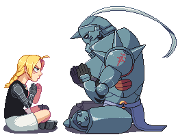

### Hi, 

 

## Open source

<!-- START_SECTION:summary -->
17 merged PRs in 11 projects, 8 more open.
<!-- END_SECTION:summary -->

<!-- START_SECTION:contributions -->
| Repository | Stars | Commits | Merged PRs | PR Links |
|:--|--:|:--:|:--:|:--|
| [pola-rs/polars](https://github.com/pola-rs/polars) | 40.3k | [1](https://github.com/pola-rs/polars/commits/main?author=Yasas-Sri) | 1 | [#30648](https://github.com/pola-rs/polars/pull/30648) |
| [storytold/wordcraft](https://github.com/storytold/wordcraft) | 18k | [3](https://github.com/storytold/wordcraft/commits/main?author=Yasas-Sri) | 3 | [#823](https://github.com/storytold/wordcraft/pull/823), [#1604](https://github.com/storytold/wordcraft/pull/1604), [#4701](https://github.com/storytold/wordcraft/pull/4701) |
| [Oldcircle/geo-sleuth](https://github.com/Oldcircle/geo-sleuth) | 7k | [5](https://github.com/Oldcircle/geo-sleuth/commits/main?author=Yasas-Sri) | 5 | [View all](https://github.com/Oldcircle/geo-sleuth/pulls?q=is%3Apr+is%3Amerged+author%3AYasas-Sri) |
| [pipeshub-ai/pipeshub-ai](https://github.com/pipeshub-ai/pipeshub-ai) | 4.1k | [1](https://github.com/pipeshub-ai/pipeshub-ai/commits/main?author=Yasas-Sri) | 1 | [#5119](https://github.com/pipeshub-ai/pipeshub-ai/pull/5119) |
| [mxsm/rocketmq-rust](https://github.com/mxsm/rocketmq-rust) | 1.5k | [1](https://github.com/mxsm/rocketmq-rust/commits/main?author=Yasas-Sri) | 1 | [#11597](https://github.com/mxsm/rocketmq-rust/pull/11597) |
| [eugenioenko/ttt](https://github.com/eugenioenko/ttt) | 1.1k | [1](https://github.com/eugenioenko/ttt/commits/main?author=Yasas-Sri) | 1 | [#1610](https://github.com/eugenioenko/ttt/pull/1610) |
| [PrismorSec/prismor](https://github.com/PrismorSec/prismor) | 487 | [1](https://github.com/PrismorSec/prismor/commits/main?author=Yasas-Sri) | 1 | [#612](https://github.com/PrismorSec/prismor/pull/612) |
| [NandhaKishorM/vegaml](https://github.com/NandhaKishorM/vegaml) | 305 | [1](https://github.com/NandhaKishorM/vegaml/commits/main?author=Yasas-Sri) | 1 | [#15](https://github.com/NandhaKishorM/vegaml/pull/15) |
| [vx-lang/Vx](https://github.com/vx-lang/Vx) | 247 | [1](https://github.com/vx-lang/Vx/commits/main?author=Yasas-Sri) | 1 | [#3015](https://github.com/vx-lang/Vx/pull/3015) |
| [facebookresearch/swe-sweep](https://github.com/facebookresearch/swe-sweep) | 238 | [1](https://github.com/facebookresearch/swe-sweep/commits/main?author=Yasas-Sri) | 1 | [#7](https://github.com/facebookresearch/swe-sweep/pull/7) |
| [Station-House/marin-neuron-hunt](https://github.com/Station-House/marin-neuron-hunt) | 4 | [1](https://github.com/Station-House/marin-neuron-hunt/commits/main?author=Yasas-Sri) | 1 | [#8](https://github.com/Station-House/marin-neuron-hunt/pull/8) |
<!-- END_SECTION:contributions -->
